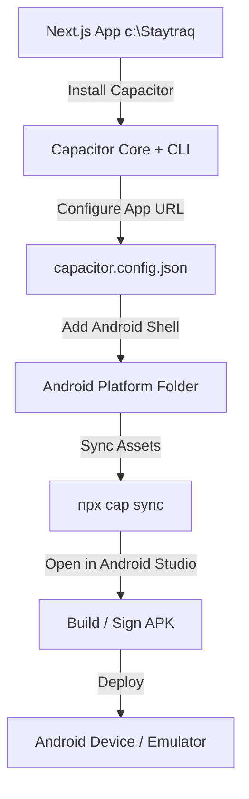

# Staytraq Android APK Conversion Plan & Guide

This document provides a comprehensive, step-by-step implementation guide to package the **Staytraq Next.js Web Application** into a high-performance, native **Android APK** using **Capacitor by Ionic**.

---

## 1. Architectural Strategy

Next.js is designed as a hybrid framework, utilizing both **client-side rendering (CSR)** and **server-side rendering (SSR)**, along with server endpoints (like `/api/...` routes) and middleware. This introduces two distinct paths for APK packaging:

### Path A: Hybrid App Shell (Recommended) ⭐
*   **How it Works**: The APK acts as a native wrapper enclosing a high-performance Android WebView that loads the hosted web application directly from your Vercel deployment (`https://staytraq.vercel.app/` or a custom domain).
*   **Pros**:
    *   **Full Feature Support**: Server action endpoints, API routes, middleware, and dynamic routes (like `/pay/[token]`) work instantly out-of-the-box without code refactoring.
    *   **Instant Updates**: Any update deployed to Vercel is instantly live on users' devices. There is no need to compile, sign, and distribute new APKs for frontend UI adjustments.
    *   **Native Capabilities**: Full access to native Capacitor plugins (Camera, Push Notifications, Clipboard, Biometrics, Share Sheet).
    *   **Authentication**: Supabase Auth cookies and sessions persist naturally within the secure WebView cookie jar.
*   **Cons**: Requires an active internet connection (which is already a prerequisite for real-time rent tracking, Supabase sync, and payment reminders).

### Path B: Local Static Bundle
*   **How it Works**: The Next.js app is compiled into a completely static export (`out` folder via `output: 'export'`), and these static assets are bundled locally inside the APK assets folder.
*   **Pros**: Off-line loading of basic shell pages.
*   **Cons**:
    *   **Server Actions & API Routes break**: Next.js API routes `/api/pay/...` cannot run inside an Android client. The app must be modified to call fully-qualified remote APIs (`https://api.staytraq.com/api/...`).
    *   **Routing Issues**: Dynamic server routes like `/pay/[token]` must be refactored to use static fallback parameters and client-side data fetching.
    *   **Harder Updates**: Any CSS, React, or static asset change requires building and redistributing a new APK.

---

## 2. Step-by-Step Implementation Flow (Path A: Hybrid App Shell)

We will use the **Hybrid App Shell (Path A)** as the primary route, as it ensures flawless execution of Staytraq's existing structure, payment endpoints, and Supabase integration with zero feature regression.



### Step 1: Install Capacitor Dependencies
Run these commands in the root of the `Staytraq` directory:

```bash
pnpm install @capacitor/core @capacitor/cli
pnpm install -D @capacitor/android
```

### Step 2: Initialize Capacitor Config
Initialize Capacitor with the application information:

```bash
npx cap init Staytraq com.staytraq.app --web-dir=public
```

This creates a `capacitor.config.json` file in the root. 

### Step 3: Configure Capacitor for Remote Hosting
Modify the generated `capacitor.config.json` (or `capacitor.config.ts`) to point directly to your deployed production/staging URL:

```json
{
  "appId": "com.staytraq.app",
  "appName": "Staytraq",
  "webDir": "public",
  "server": {
    "url": "https://staytraq.vercel.app/",
    "cleartext": true
  },
  "android": {
    "allowMixedContent": true
  }
}
```

> [!NOTE]
> Setting the `server.url` tells Capacitor to point the WebView to your hosted domain instead of local assets, preserving all SSR pages, cookie paths, and Supabase hooks.

### Step 4: Add the Android Native Platform
Generate the native Android studio project folder:

```bash
npx cap add android
```

This creates an `android` directory in your root folder. This folder is a fully-fledged Android Studio project that you can open, build, and sign.

### Step 5: Sync Capacitor State
Whenever you modify the configuration, sync it with the native Android project:

```bash
npx cap sync android
```

---

## 3. Configuring Native Android Optimizations

To make Staytraq feel like a premium native mobile application instead of a website in a browser, we must configure a few vital files inside the `android` platform folder.

### 1. Handling Safe Areas & StatusBar Styling
By default, the Android Status Bar might overlay your UI or appear as a generic solid gray. We can configure a transparent status bar to allow the app colors to flow to the very top.

Modify `android/app/src/main/res/values/styles.xml`:
```xml
<resources>
    <!-- Base application theme. -->
    <style name="AppTheme" parent="Theme.AppCompat.Light.DarkActionBar">
        <!-- Customize your theme here. -->
        <item name="colorPrimary">#0F172A</item> <!-- Slate 900 -->
        <item name="colorPrimaryDark">#0F172A</item>
        <item name="colorAccent">#3B82F6</item> <!-- Blue 500 -->
    </style>

    <style name="AppTheme.NoActionBar" parent="Theme.AppCompat.Light.NoActionBar">
        <item name="windowActionBar">false</item>
        <item name="windowNoTitle">true</item>
        <item name="android:windowLayoutInDisplayCutoutMode">shortEdges</item>
    </style>
</resources>
```

### 2. Handling the Android Back Button
In a WebView app, clicking the physical Android back button can accidentally exit the app instead of going back in the page history. 

We can handle this cleanly using a Capacitor listener in `app/layout.tsx` or a custom React hook:

```typescript
// lib/hooks/useMobileBackButton.ts
import { useEffect } from 'react'
import { App } from '@capacitor/app'
import { useRouter } from 'next/navigation'

export function useMobileBackButton() {
  const router = useRouter()

  useEffect(() => {
    // Check if running inside Capacitor
    if (typeof window === 'undefined' || !window.hasOwnProperty('Capacitor')) return

    const setupListener = async () => {
      await App.addListener('backButton', ({ canGoBack }) => {
        if (canGoBack) {
          window.history.back()
        } else {
          App.exitApp()
        }
      })
    }

    setupListener()

    return () => {
      App.removeAllListeners()
    }
  }, [router])
}
```

---

## 4. Building the APK (Debug & Release)

### Method 1: Building with Android Studio (Visual)
1.  **Open Android Studio**.
2.  Click **Open an Existing Project** and select the `android` folder in your `Staytraq` workspace.
3.  Wait for Gradle to finish sync and indexing (this can take 2-3 minutes).
4.  **For Debug APK**:
    *   Go to **Build** > **Build Bundle(s) / APK(s)** > **Build APK(s)**.
    *   Android Studio will compile the app and provide a popup: *APK(s) generated successfully: Locate*. Click **Locate** to find `app-debug.apk`.
5.  **For Signed Production APK**:
    *   Go to **Build** > **Generate Signed Bundle / APK...**
    *   Choose **APK** and click Next.
    *   Create a Keystore file (if you don't have one) and fill in your app passwords.
    *   Select **release** build variant.
    *   Click **Finish** to build `app-release.apk` ready for distribution.

### Method 2: Building with CLI (Headless)
If you prefer building directly from the command line without opening Android Studio, you can use the Gradle wrapper inside the `android` folder:

```powershell
# Navigate into the android directory
cd android

# Compile a Debug APK
./gradlew assembleDebug
```
The compiled debug APK will be created at:
`c:\Staytraq\android\app\build\outputs\apk\debug\app-debug.apk`

---

## 5. Verification & Deployment Checklist

Before rolling out the APK to production, verify the following critical functionalities:

1.  **Auth Persistence**: Log in to Staytraq on the APK, force-close the app, and reopen it. Verify that the session is retained and the user is not redirected to `/login`.
2.  **Payments Processing Flow**: Verify that the payment timelines and steps `/pay/[token]` load beautifully in the mobile WebView shell and execute successfully.
3.  **Reminders Dispatch**: Verify that click-to-SMS/Twilio or browser redirection behaves perfectly under WebView constraints.
4.  **Network Resilience**: Verify that the app handles offline states gracefully, displaying a premium "No Internet Connection" visual wrapper instead of standard browser errors.

---
*Implementation Plan Created by Antigravity.*
